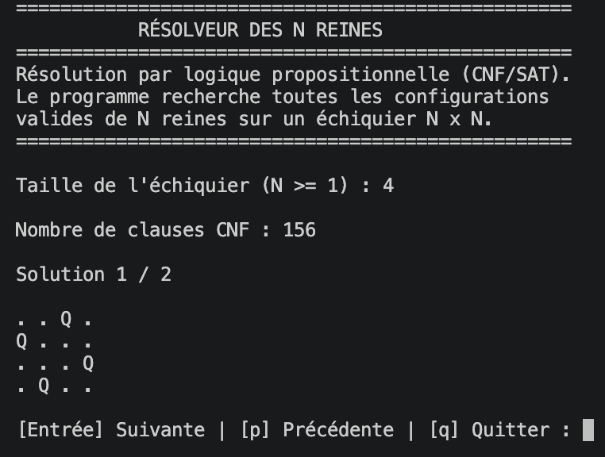

# Résolveur du problème des N reines

## Description

Ce projet consiste à résoudre le problème des **N reines** à l'aide de la logique propositionnelle et d'un solveur SAT.

L'objectif est de placer N reines sur un échiquier de taille N × N sans qu'elles puissent s'attaquer.

Le programme recherche toutes les solutions possibles et permet de les consulter dans le terminal.

## Aperçu du programme



## Méthodologie

Le problème est traduit en **forme normale conjonctive (CNF)** à partir de cinq contraintes :

1. Au maximum une reine par ligne.
2. Au maximum une reine par colonne.
3. Au maximum une reine par diagonale descendante.
4. Au maximum une reine par diagonale montante.
5. Au moins une reine par ligne.

Les clauses CNF sont ensuite transmises au solveur **Glucose3**, fourni par la bibliothèque PySAT.

### Remarque sur les clauses CNF

Certaines clauses générées sont redondantes. Par exemple, `[-1, -2]` et `[-2, -1]` représentent la même contrainte logique.

Ces redondances sont volontairement conservées afin de **respecter la traduction directe des formules de logique propositionnelle vues en cours**.

Le programme privilégie ainsi la fidélité à la démarche mathématique plutôt que l'optimisation du nombre de clauses.

## Technologies utilisées

- Python 3
- PySAT (`python-sat`)
- Glucose3

## Structure du projet

```text
n-reines/
├── captures/
│   └── preview.png
├── modules/
│   ├── __init__.py
│   ├── cnf.py
│   ├── interface.py
│   └── sat_solver.py
├── main.py
├── requirements.txt
└── README.md
```

- `cnf.py` : génération des clauses CNF.
- `sat_solver.py` : recherche des solutions avec PySAT.
- `interface.py` : saisie et affichage des solutions.
- `main.py` : point d'entrée du programme.

## Installation

Créer un environnement virtuel :

```bash
python3 -m venv .venv
```

L'activer sur macOS ou Linux :

```bash
source .venv/bin/activate
```

L'activer sur Windows :

```bash
.venv\Scripts\Activate.ps1
```

Installer les dépendances :

```bash
python -m pip install -r requirements.txt
```

## Exécution

Depuis la racine du projet :

```bash
python main.py
```

Saisir ensuite la taille `N` de l'échiquier.

Le programme affiche le nombre de clauses CNF et permet de parcourir les solutions trouvées.

**Navigation :**
- `Entrée` : solution suivante.
- `p` : solution précédente.
- `q` : quitter.

## Résultats attendus

| N | Nombre de solutions |
|---|---:|
| 1 | 1 |
| 2 | 0 |
| 3 | 0 |
| 4 | 2 |
| 5 | 10 |
| 8 | 92 |

Les valeurs N = 2 et N = 3 permettent de vérifier la gestion des cas sans solution.

## Consignes du projet

Ce projet respecte la démarche demandée :

**Logique propositionnelle → CNF → SAT**

Les critères d'évaluation portent sur la correction des solutions, la démarche méthodologique, la clarté du code, la gestion des cas particuliers et les performances pour N ≥ 8.